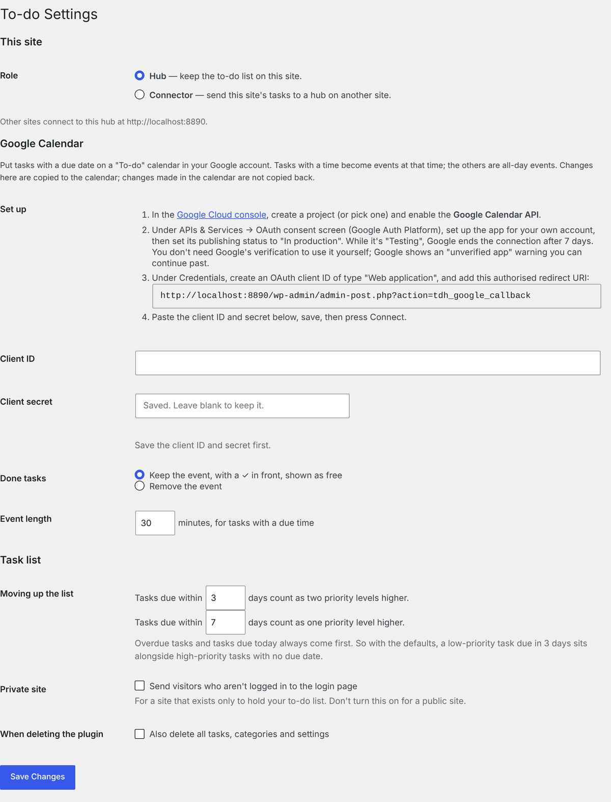

# All your sites, one list

Install To-do Hub on every site. One site is the **hub** and keeps the list. The others are **connectors**: their tasks, including the ones their plugins add, go to the hub.

## Setting up

The hub needs **https**, because WordPress only accepts application passwords over https.

On the **hub**:

1. Under **To-do → Settings → Role**, keep **Hub**. The page shows the address other sites connect to.
2. Under **Users → Add New**, add a user with the **To-do Connector** role. It can only work with tasks.
3. In that user's profile, under **Application Passwords**, create one named after the other site, and copy it.

On each **other site**:

1. Under **To-do → Settings → Role**, choose **Connector**.
2. Enter the hub's address, the user name and the application password, and save.
3. The page says whether the connection works. **To-do** on that site then shows the tasks it has sent, with a link to the hub.

## What happens then

- Plugins on a connected site add tasks exactly as they would on the hub. On the hub, those tasks show **from where-to-buy on example.com**, and you can filter by site.
- Ticking a task off on the hub can tell the site that added it, so that plugin knows the task is done. Plugins ask for this per task.
- If the hub can't be reached, changes wait on the connected site and are sent in order every five minutes. Each change is tried for about two days.
- Each connected site keeps its own settings. Only the hub has the list, the dashboard widget's full list and Google Calendar.
