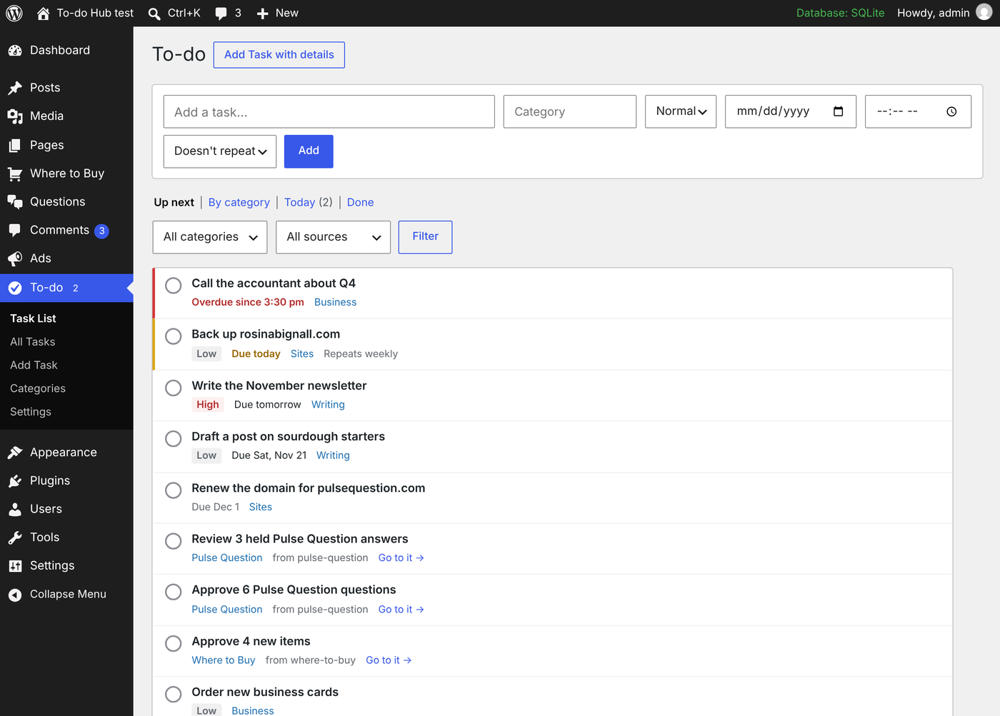

# Getting started

To-do Hub needs WordPress 6.4 or later and PHP 8.1 or later.

## Install

1. Download `todo-hub-x.y.z.zip` from the [latest release](https://github.com/bignall/todo-hub/releases/latest).
2. In WordPress, go to **Plugins → Add New → Upload Plugin**, choose the zip, and activate it.
3. Open **To-do** in the admin menu.

## Add your first tasks

At the top of the task list, type a task and press **Add**. You can also pick a category, a priority, a due date, a time and a repeat in the same row. **Add Task with details** opens the full editor, for longer notes and a link. See [Tasks](tasks.md).

## One site, or all of them

If you run several WordPress sites, choose one to keep the list: the **hub**. Install To-do Hub on the others too, set them to **Connector**, and their tasks go to the hub. See [All your sites, one list](all-your-sites.md).

## A site just for your list

If the hub is a site you made only for your to-do list (for example todo.example.com), turn on **To-do → Settings → Private site**. Visitors who aren't logged in are then sent to the login page. Don't turn this on for a public site.

## Keep the clock running

Repeats, reminders from other plugins, connections between sites and Google Calendar all rely on WP-Cron. WP-Cron only runs when someone visits the site, so on a quiet site, have your host load `wp-cron.php` every five minutes (on SiteGround: *Site Tools → Devs → Cron Jobs*), and add `define( 'DISABLE_WP_CRON', true );` to `wp-config.php`.
