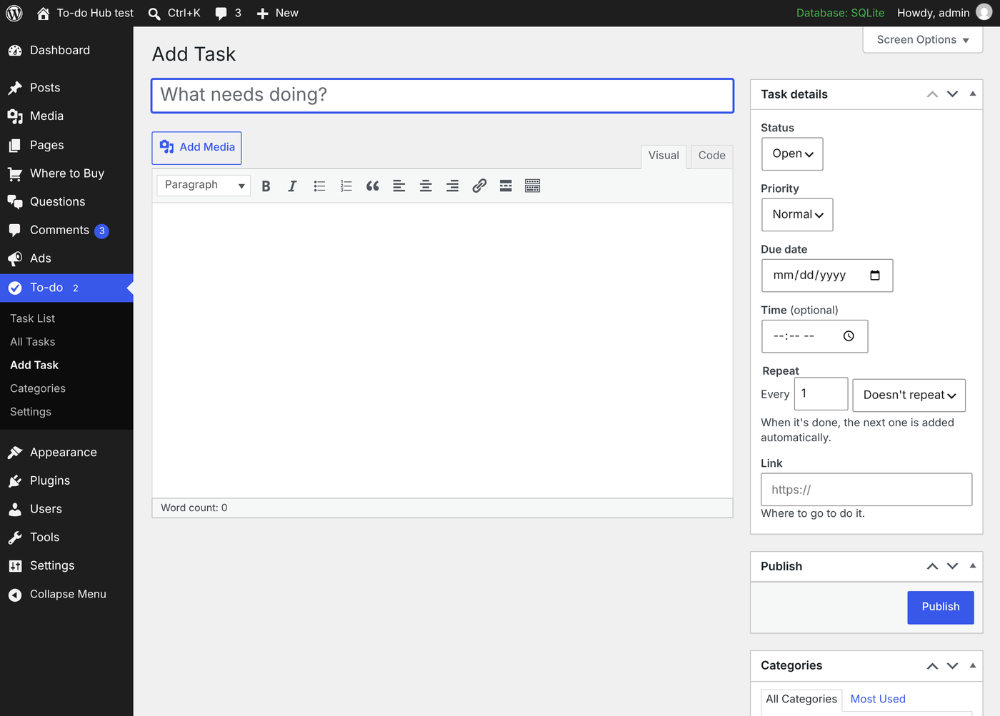
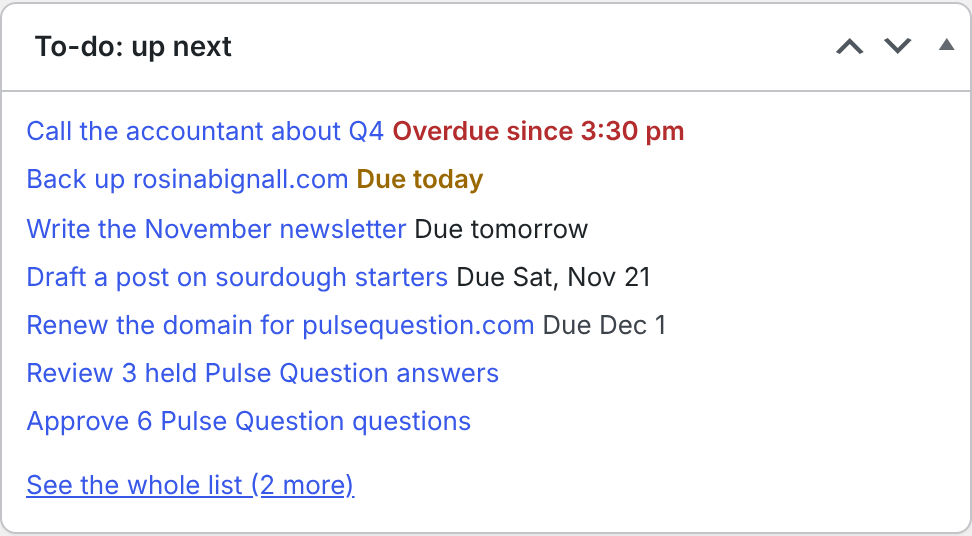

# Tasks

## Adding tasks

- **Quick add**, at the top of the task list: a title, then optionally a category, a priority (high, normal or low), a due date, a time and a repeat.
- **Add Task with details** (or **To-do → Add Task**): the same, plus notes (with formatting, links and images) and a **link** to where the task gets done, such as an admin screen or a document.
- **Categories** are created as you type them. Manage them under **To-do → Categories**.

## Due dates and times

A task can have no due date, a date, or a date and a time.

A task with a time counts as overdue once that time has passed. A task without a time is due any time that day, and becomes overdue the next day. Dates and times use your site's time zone (**Settings → General**).

## Repeating tasks

Choose **Daily**, **Weekly**, **Every 2 weeks**, **Monthly** or **Yearly**. In the editor you can set any number of days, weeks, months or years.

When you tick off a repeating task, the next one is added. It's due one step after the old due date, moved on until it's after today. So finishing a weekly task late doesn't leave next week's already overdue. A repeating task with no due date comes back one step after the day you finished it.

## How the list is sorted

**Up next** puts what needs doing first at the top:

1. **Overdue** tasks (marked red), then tasks **due today** (marked amber). Within each, high priority comes first.
2. **Everything else by priority**, with tasks moving up as their due date gets close:
   - a task due within 3 days counts as two priority levels higher;
   - a task due within 7 days counts as one level higher.

   So a low-priority task due tomorrow sits with high-priority tasks that have no date.
3. **Ties** go to the earlier due date and time. Tasks with no date come last, and on the same day, tasks with a time come before those without. Then the older task comes first.

Change the 3 and 7 days under **To-do → Settings → Task list**.

## Views and filters

- **Up next:** every open task, sorted as above.
- **By category:** the same, grouped by category.
- **Today:** overdue tasks and tasks due today. The number next to it, and on the **To-do** menu item, counts them.
- **Done:** finished tasks, newest first. Click a task's tick to reopen it.

Filter any view by **category**, or by **source**: the plugin or site that added the task.

## Ticking things off

Click the circle next to a task. It moves to **Done**, and an **Undo** link lets you change your mind. Tasks added by another plugin are often ticked off by that plugin when the problem is fixed. For example, Pulse Question ticks off "Approve 6 questions" once you've approved them.

To remove a task that no longer needs doing, move it to the Trash from **To-do → All Tasks**.

## The dashboard widget

**To-do: up next** on the WordPress dashboard shows the first few tasks with their due dates, and links to the whole list.

